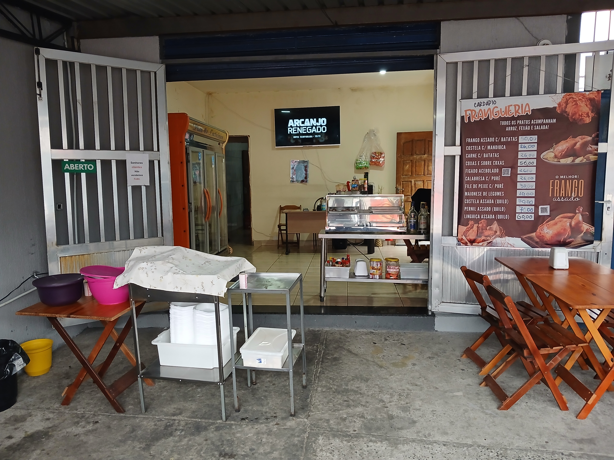
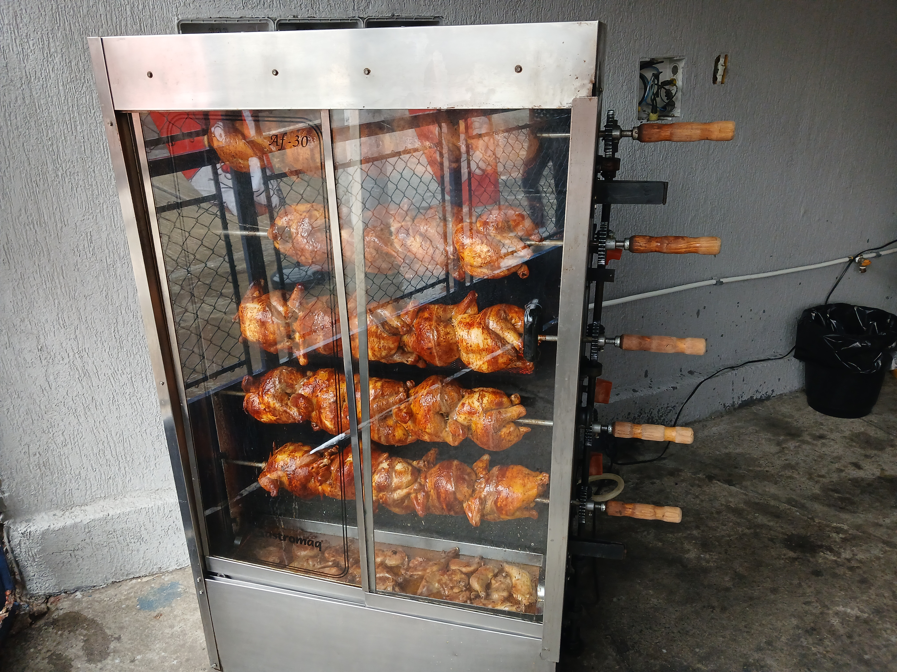
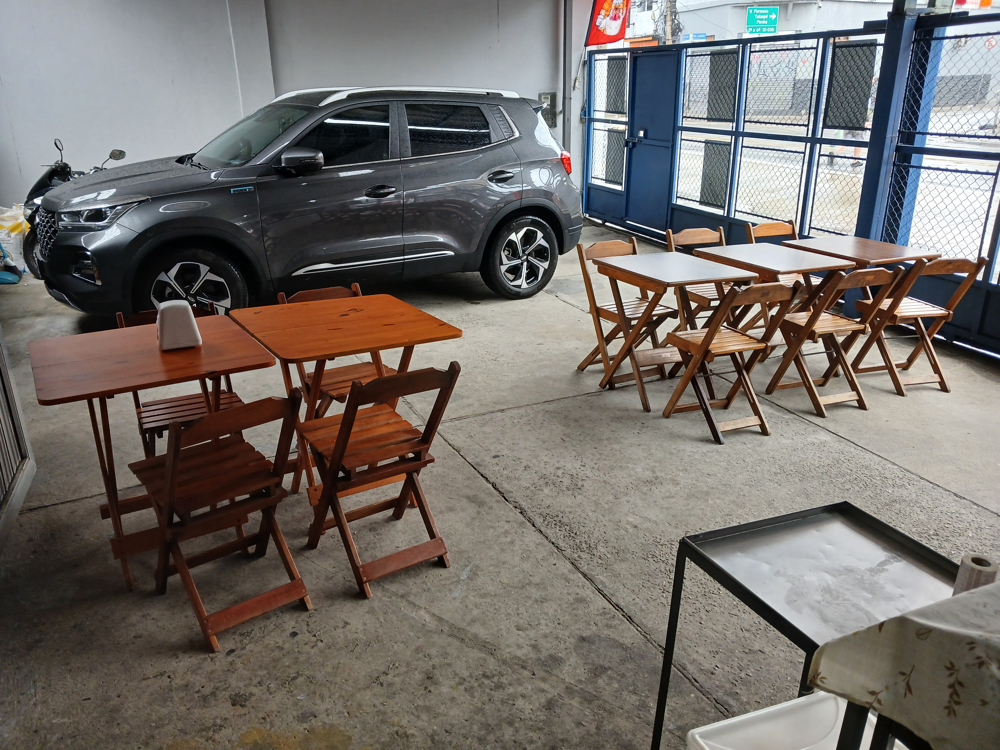
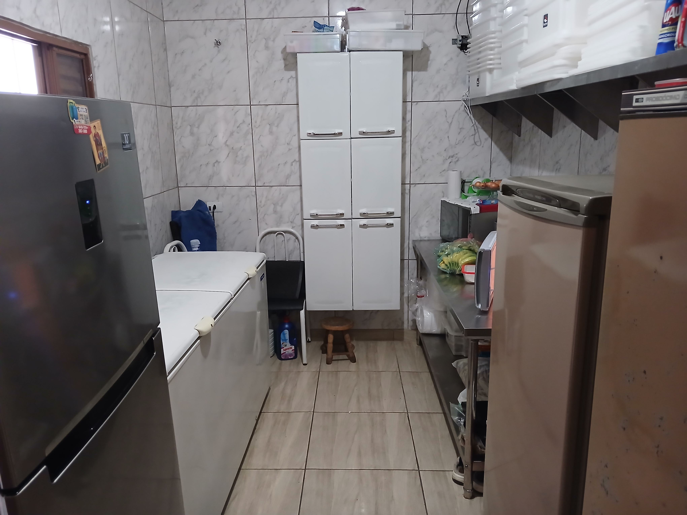
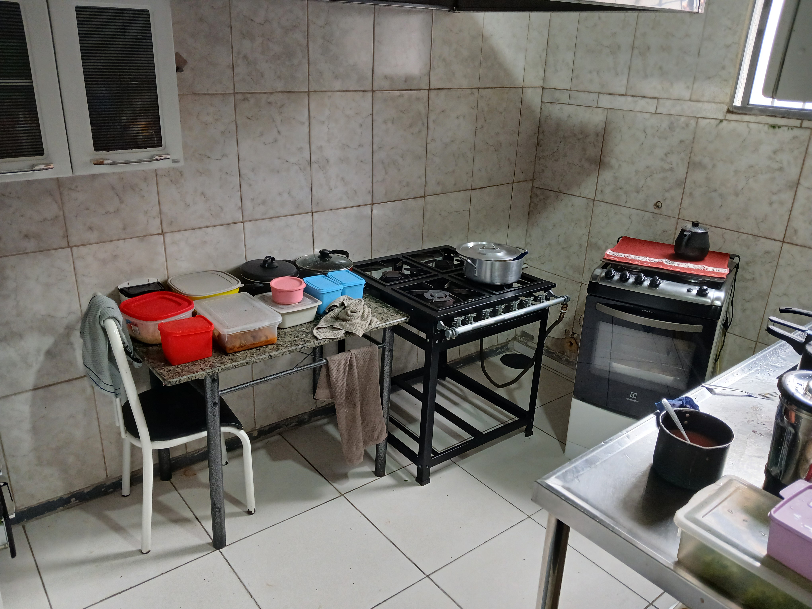
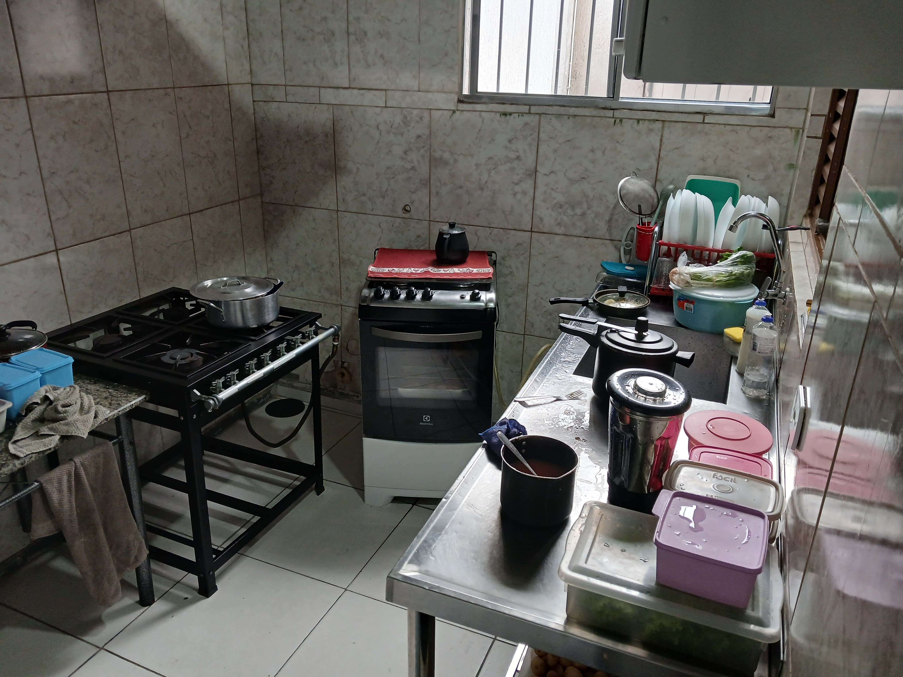
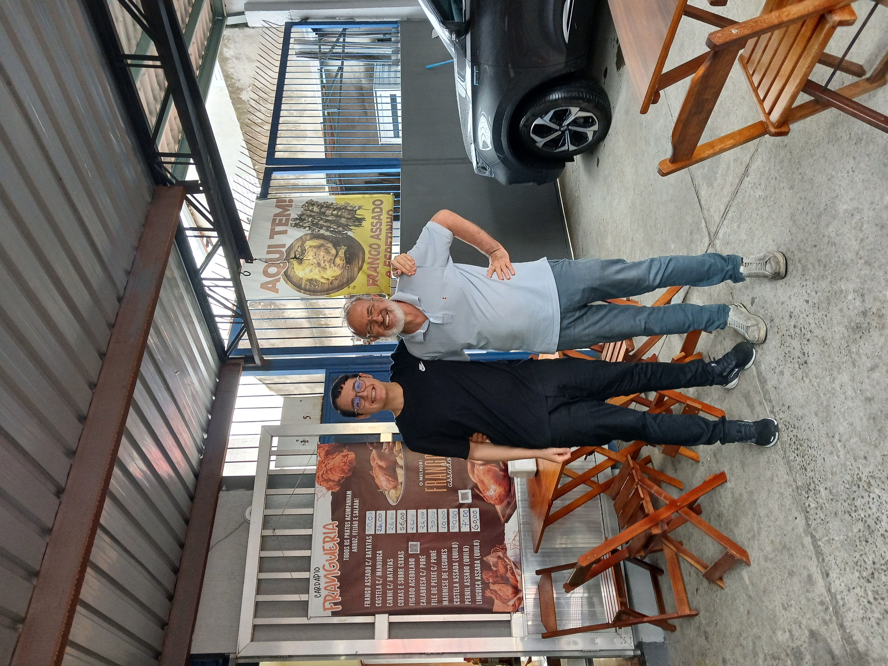
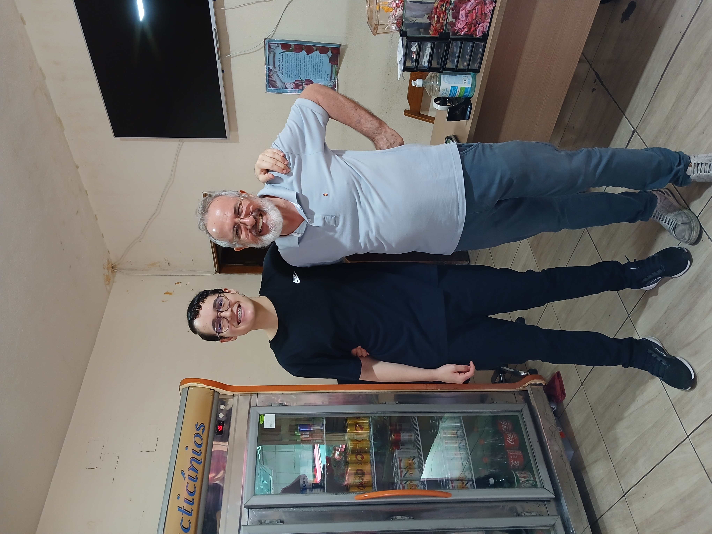
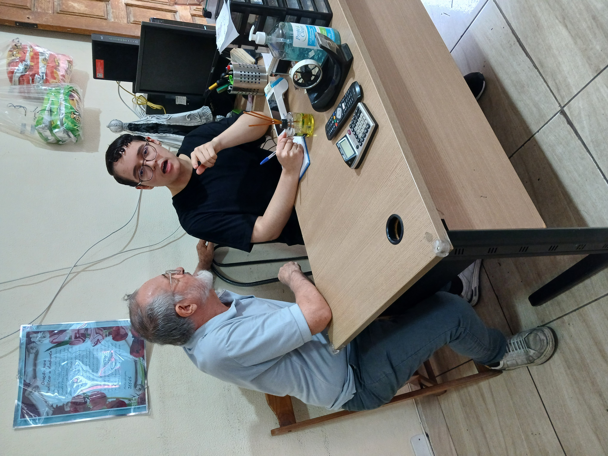
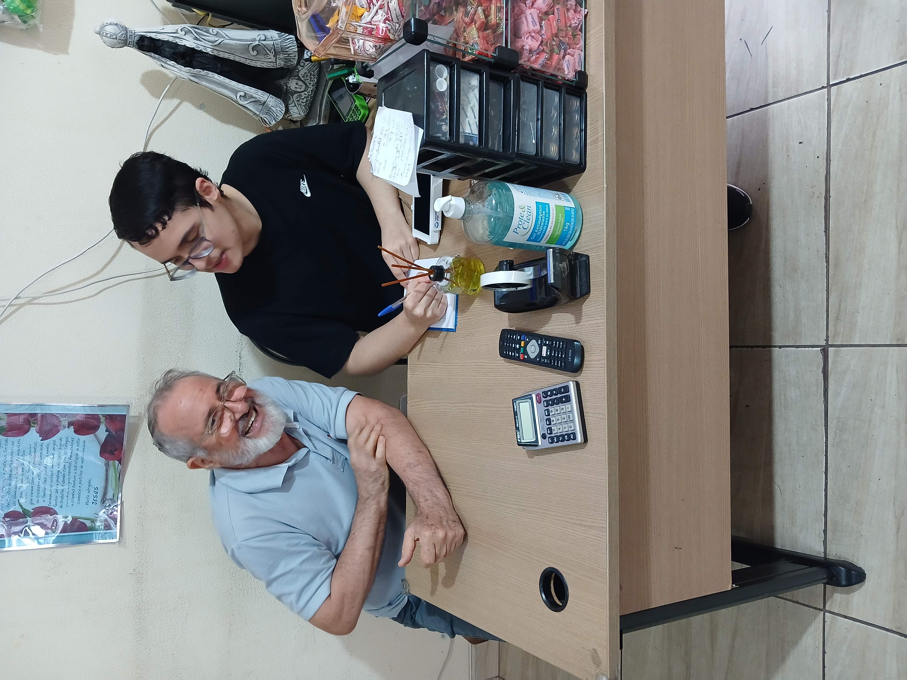

# Entrega 2 — Modelo Lógico, implementação SQL e apresentação Final

### Modelagem de dados para um sistema de uma organização de pequeno porte

> Este arquivo é o esqueleto do **README.md** do repositório GitHub do seu grupo.
> Preencha cada seção abaixo. Não apague os títulos — apenas substitua as instruções em *itálico* pelo conteúdo do seu projeto.
> O **DER** é anexado separadamente ao repositório (em imagem), mas sua justificativa entra neste README.
>
> **A organização escolhida pode ser de qualquer natureza:** empresa com fins lucrativos (livraria, restaurante, pet shop), ONG, associação comunitária, cooperativa, instituições religiosas/comunitárias como igrejas, terreiros de religiões de matriz africana (candomblé, umbanda) ou outras. O que muda de um tipo para outro são os processos e as regras específicas — a estrutura do trabalho (levantamento de requisitos, modelagem conceitual, DER) é a mesma para todas. Termos como "empresa" e "negócio" usados abaixo devem ser lidos de forma ampla, no sentido técnico de modelagem de dados (ex.: "regras de negócio" = regras de funcionamento da organização, seja ela comercial, religiosa ou social).
>
> **Importante:** a organização precisa **existir de fato** — não é permitido inventar uma organização fictícia. O levantamento de requisitos e regras de negócio deve ser feito por meio de **pesquisa de campo na própria organização** (visitas, entrevistas com responsáveis, observação dos processos reais), então o grupo só deve escolher uma organização à qual **realmente tenha acesso**. Ao escolher, tomem cuidado com o porte: **nem tão pequena** que não gere dados suficiente para o trabalho (poucos processos, poucas entidades), **nem tão grande/complexa** que fique inviável de modelar nesta primeira etapa do curso.

---

## Metadados dos estudantes

| Nome completo do estudante | RGM | Nome de usuário do GitHub 
| :--- | :--- | :--- |
| Alessa Araújo Ctvrtnik | 49508610 | Alessa-777
| João Vitor Mendes Almeida | 49744453 | joaovitormendes-tech
| Matheus Ferreira da Silva | 47903520 | mMatheus-F
| Otávio Teixeira Lopes da Silva| 47880414 | otavioteixeiralopes80-lab
| Paulo Sergio Olivastro | 47962241 | paulo-dev-coder

## 1. Relatório Técnico Final

### 1.1 Revisão do Modelo Conceitual

- **Nome oficial do estabelecimento:** A Frangueria

- **Natureza da organização:** A natureza da organização é um estabelecimento comercial familiar de pequeno porte que vende refeições completas, bebidas e frango assado com acompanhamentos. Seu modelo de negócio combina restaurante de prato feito e galeteria.

- **Contexto e porte:** A organização é uma microempresa com fins lucrativos, direcionada à geração legítima de renda e à sustentabilidade do negócio. A operação é compacta e voltada ao consumidor final. Não há funcionários terceirizados, prestadores de serviço externos ou voluntários; a gestão, a cozinha e o atendimento são realizados pelos próprios membros da família.

  - **Funcionamento e estrutura física:** O estabelecimento funciona aos sábados e domingos, das 10h às 20h, com possibilidade de extensão do horário quando ainda houver clientes no local. A equipe é composta por três pessoas: uma responsável pela cozinha, uma pelo caixa e uma pelo atendimento. A área externa do restaurante possui 5 mesas, e o salão interno possui 2 mesas, totalizando 7 mesas com capacidade para aproximadamente 24 pessoas sentadas.

  - **Volume de operação:** A operação concentra-se apenas nos fins de semana. Em um dia típico de funcionamento, são registrados de 10 a 14 pedidos, o equivalente a 20 a 28 pedidos por semana. O cardápio é fixo, com 5 itens de refeição, e são preparados 14 frangos no sábado e 24 no domingo. Os fornecedores são frigoríficos e um atacadista de alimentos, com compra semanal. O preço médio do conjunto, ou seja, a refeição e a bebida, fica entre R$25,00 e R$30,00. O preço médio da bebida isolada varia de R$4,00 a R$15,00.

  - **Registro de informações:** O registro dos pedidos é feito no computador, sob controle do representante legal da empresa, e os recebimentos são anotados na máquina de pagamento, que faz e controla as transações.

- **Problemas e necessidades identificados:**

  - **P1 —  Registro de pedidos fragmentado e sem consulta gerencial:**
    - Os pedidos são registrados no computador, sob controle do representante legal, e os recebimentos são anotados na máquina de pagamento. Não há integração entre os dois registros. O impacto é a impossibilidade de consolidar, em uma única consulta, pedidos e valores recebidos por período, cliente, produto ou forma de pagamento. A recuperação de histórico depende de consulta manual a cada um dos sistemas;

  - **P2 — Conciliação manual entre máquina e dinheiro em espécie:**
    - O fechamento do caixa é feito pela máquina de pagamento em cerca de 5 minutos, pelo tesoureiro. No entanto, o total em dinheiro é conferido separadamente, sem registro integrado à máquina. O impacto é a ausência de conciliação formal entre os dois meios, o que dificulta identificar divergências entre os valores registrados e os efetivamente recebidos;

  - **P3 —  Perdas e rastreio de lote sem registro:**
    - Há controle de disponibilidade e de estoque com quantidade mínima de segurança a partir da supervisão da cozinheira com acompanhamento do representante. Porém, as perdas por vencimento ou deterioração são descartadas sem registro, e não há vínculo entre a encomenda e o lote de origem. O impacto é a impossibilidade de medir perdas e de controlar com precisão a quantidade de frango produzida e vendida;

  - **P4 — Falta de histórico de compras por fornecedor e produto:**
    - As compras são semanais, calculadas para o consumo, e conferidas pelo tesoureiro. Não há, porém, registro estruturado por fornecedor e por produto que permita comparar preços ao longo do tempo, identificar frequência de compra ou apoiar negociação. O impacto é a dependência de memória e de anotações dispersas para decisões de compra;

  - **P5 — Divergências e descartes sem registro:**
    - O recebimento é conferido pelo tesoureiro, mas divergências de quantidade ou qualidade não são registradas formalmente. A mercadoria não consumida é descartada sem registro. O impacto é a impossibilidade de rastrear perdas, cobrar fornecedores ou ajustar o planejamento de compras.

- **Escopo do sistema**: O banco de dados deve reunir todos os dados da organização, e não apenas os dados de apenas um setor ou processo. A modelagem cobre o ciclo completo da operação, sendo: cadastro de pessoas, clientes e funcionários, gestão de mesas, catálogo de produtos e insumos, compras e recebimento de mercadoria, controle de estoque, registro de pedidos e itens, encomendas antecipadas de frango, faturamento, emissão de nota fiscal e fechamento de caixa.

- **Justificativa da escolha:** A escolha do estabelecimento fundamenta-se em três critérios:

  - **Primeiro, o acesso garantido à organização.** Um dos integrantes do grupo é filho dos proprietários, o que viabilizou a realização da entrevista com o responsável no ambiente da organização e a observação direta da rotina operacional. O vínculo familiar foi declarado à disciplina e não substitui a comprovação da entrevista, registrada na seção 1.1 com nome, data, local e foto;

  - **Segundo, o porte compatível com o escopo da disciplina.** Trata-se de uma microempresa familiar com funcionamento aos sábados e domingos, das 10h às 20h, cuja operação — com 7 mesas, 20 a 28 pedidos por fim de semana e fornecedores recorrentes (frigoríficos e um atacadista de alimentos) — permite mapear todos os processos sem a complexidade de organizações de maior porte, mantendo volume suficiente de dados para a modelagem e para a massa de dados da seção 4;

  - **Terceiro, o modelo de negócio misto.** A combinação de restaurante de prato feito e frangaria exige entidades específicas para controle de produção por lote (LOTE_FRANGO) e para encomendas antecipadas (RESERVA_FRANGO), sem rateio por lote, conforme levantamento. Essa estrutura amplia a cobertura de processos em relação a um restaurante convencional e justifica a inclusão dessas entidades no DER.

- **Evidências da organização:** A existência, o acesso e a entrevista à organização são comprovados pelos registros abaixo.

  - **Endereço da organização:**
Av. Celso Garcia, nº 1115 - Catumbi, São Paulo - SP

  - **Link público da organização no Google Maps (Google Meu Negócio):**
https://maps.app.goo.gl/pjqxhT2Ltq6g1c2D7?g_st=ac

  - **Fotos do local:**
    
    
    
    
    
    

  - **Fotos da visita à organização:**
    
    

  - **Fotos da entrevista:**
    
    

  - **Responsável pela organização:**
    - **Nome:** Sergio Olivastro
    - **Número de telefone para contato, caso queira confirmar as informações:** +55 11 92017-3732

### Relato da entrevista

**Quem:** A entrevista foi realizada com **Sergio Olivastro**, o proprietário e representante legal do restaurante. Quem participou da visita foi o integrante do grupo **Paulo Sergio Olivastro**.

**Quando e onde:** A visita técnica e a entrevista semiestruturada ocorreram no dia **01 de novembro de 2026**, no ambiente da organização, com duração de aproximadamente **45 minutos**. A entrevista foi realizada presencialmente no escritório administrativo do restaurante, com observação direta da rotina de abertura, preparo e organização.

**Comprovação:** A presença no local e a realização da entrevista estão documentadas por fotos em JPG, armazenadas na pasta `evidencias/` do repositório. O levantamento completo, com as 22 perguntas e respostas, está disponível no arquivo [`levantamento/levantamento.md`](levantamento/levantamento.md).

**O que foi levantado e o que mudou em relação à primeira entrega:** 
A entrevista com o representante legal e a revisão do escopo foram fundamentais para corrigir as falhas apontadas na correção da Entrega 1. As principais mudanças, alinhadas aos critérios da correção, foram:

- **Comprovação da entrevista:** Na primeira entrega, não havia comprovação de contato. Nesta entrega, a visita presencial foi realizada, documentada com fotos no repositório e detalhada neste relato;
- **Caracterização com números:** A primeira entrega foi penalizada por utilizar adjetivos vagos como "operação compacta". Agora, a caracterização apresenta dados reais coletados na visita: sete mesas, sendo 5 externas e 2 internas, capacidade para 24 pessoas, e um volume de 20 a 28 pedidos por semana;
- **Processos e regras de negócio:** A correção apontou ausência de processos como compras e estoque, além de regras genéricas. Foram adicionados os processos de Compra, Recebimento e Estoque, e as regras de negócio foram reescritas com base na realidade como por exemplo: a máquina faz o fechamento em 5 minutos; não há rateio de lote;
- **Correção estrutural do DER:** A primeira entrega tinha erros graves: relacionamentos `(1,n)` em ambos os lados, chaves estrangeiras desenhadas e a entidade `LOTE_FRANGUERIA` com chave duplicada. O DER da E2 resolveu tudo isso, adotou a generalização para Pessoa/Cliente/Funcionário e promoveu MESA a entidade própria, conforme exigido pelo professor;
- **Registro de pedidos e fechamento de Caixa:** Descobertas importantes da entrevista alteraram o modelo. O que antes se achava que era caderneta, na verdade é um registro no computador e na máquina de pagamento, o que justifica os problemas P1 e P2;
- **Cardápio e produção:** Confirmou-se que o cardápio tem **5 itens fixos** e a produção diária é de 14 frangos no sábado e 24 no domingo, o que justifica a entidade `LOTE_FRANGO`;
- **Escopo de dados e LGPD:** A primeira entrega coletava dados desnecessários. A entrevista confirmou que apenas nome e telefone são coletados, eliminando CPF, e-mail e data de nascimento do modelo. Além disso, a entidade `NOTA_FISCAL` foi incluída para refletir a emissão fiscal permanente citada pelo proprietário;
- **Exclusões confirmadas:** A pesquisa em campo confirmou que **não há reserva de mesa**, **não há delivery** e **não há rastreio de lote por encomenda** (apenas nota de saída), removendo essas premissas incorretas da E1.

### Processos de negócio

**Principais processos mapeados e representados no DER:**

- **PN01:** **Cadastro de pessoas, clientes e telefones:** nome, telefone com número e tipo; cliente com data de cadastro.
- **PN02:** **Cadastro de funcionários:** nome, salário, cargo e situação.
- **PN03:** **Cadastro de produtos do cardápio:** nome, descrição, preço, categoria e disponibilidade.
- **PN04:** **Cadastro de insumos:** frango, temperos, embalagens e bebidas; unidade, quantidade em estoque e estoque mínimo.
- **PN05:** **Cadastro de fornecedores:** nome, contato e itens fornecidos.
- **PN06:** **Gestão de mesas:** controle das 7 mesas (5 externas e 2 internas), com capacidade e status de ocupação.
- **PN07:** **Compra de frango e insumos:** data, fornecedor, itens, quantidade, valor unitário, valor total e situação.
- **PN08:** **Recebimento da mercadoria:** data, compra vinculada, itens conferidos pelo tesoureiro, quantidade recebida e registro de divergências.
- **PN09:** **Movimentação de estoque:** entrada por recebimento, saída por consumo, ajuste manual; quantidade, data, motivo e descarte de perdas.
- **PN10:** **Atendimento e registro do pedido:** data/hora de abertura, tipo de consumo (local/retirada), vínculo com a mesa (quando local), cliente, funcionário responsável e situação.
- **PN11:** **Composição do pedido:** produto, quantidade, valor aplicado e observação.
- **PN12:** **Encomenda antecipada de frango:** pedido de origem, quantidade, horário de retirada, pagamento antecipado, emissão de duas vias (empresa e cliente) e situação.
- **PN13:** **Produção de frango por lote:** data de produção, quantidade produzida (14 no sábado, 24 no domingo), quantidade disponível e produto.
- **PN14:** **Faturamento ou pagamento:** pedido, data de pagamento, valor total, forma (dinheiro, Pix, débito, crédito) e situação; sem armazenar dados de cartão.
- **PN15:** **Emissão de Nota Fiscal:** geração do documento fiscal (número, série, data e tipo) vinculado ao faturamento.
- **PN16:** **Fechamento do caixa do dia:** data, tesoureiro responsável, fechamento pela máquina, conferência do dinheiro em espécie e divergências.
- **PN17:** **Preparo e retirada:** o pedido é efetuado, pago, preparado pela cozinha, o cliente é avisado e o pedido é entregue/encerrado.
- **Fluxograma:** A organização optou por não inserir o fluxograma.

**Processos prováveis não incluídos e justificativa:**
- **Entrega em domicílio:** não incluído porque a organização não realiza entregas, atuando apenas no local e por retirada (conforme Q22).
- **Reserva de mesa:** não incluído porque o restaurante não trabalha com agendamento prévio de mesas (conforme Q4).
- **Rateio de encomenda por lote:** não incluído porque a organização não registra de qual lote específico saiu cada parte da encomenda; o controle é feito apenas pela nota de saída (conforme Q21).
- **Controle automatizado de ingredientes por receita:** não existe, pois a baixa de estoque é feita por movimentação manual e conferência visual da equipe.

### Requisitos do sistema

#### Requisitos funcionais

| Código | Requisito funcional |
| :--- | :--- |
| **RF01** | Cadastrar produtos do cardápio com nome, descrição, preço, categoria e disponibilidade. |
| **RF02** | Cadastrar pessoas e clientes, mantendo os dados cadastrais (nome). |
| **RF03** | Registrar um ou mais telefones associados à pessoa, com número e tipo. |
| **RF04** | Cadastrar funcionários que operam o sistema, com cargo, salário-base e situação. |
| **RF05** | Cadastrar as mesas do restaurante com número, localização (externa/interna), capacidade e status de ocupação. |
| **RF06** | Cadastrar insumos (frango, temperos, embalagens, bebidas) com unidade de medida, quantidade em estoque e estoque mínimo. |
| **RF07** | Cadastrar fornecedores com nome, contato e CNPJ. |
| **RF08** | Registrar compras semanais com data, fornecedor, valor total e situação. |
| **RF09** | Registrar os itens de cada compra, contendo o insumo, a quantidade e o valor unitário. |
| **RF10** | Registrar o recebimento da mercadoria, contendo a data, a compra vinculada, quem conferiu (funcionário) e eventuais divergências. |
| **RF11** | Registrar movimentações de estoque (entrada por recebimento, saída por consumo, ajuste manual ou descarte de perdas), com quantidade, data e motivo. |
| **RF12** | Registrar a produção diária de frango por lote, contendo data, quantidade produzida e quantidade disponível. |
| **RF13** | Registrar pedidos com data/hora de abertura, tipo de consumo (local/retirada), cliente, funcionário responsável e mesa associada (quando consumo local). |
| **RF14** | Incluir no pedido os itens, com quantidade, valor aplicado e observação, cada qual relacionado a um produto. |
| **RF15** | Registrar encomenda antecipada de frango vinculada ao pedido, com quantidade reservada, horário de retirada, pagamento antecipado e situação. |
| **RF16** | Registrar o faturamento associado ao pedido, com data do pagamento, valor total, forma (dinheiro, Pix, débito, crédito) e situação. |
| **RF17** | Registrar a emissão de Nota Fiscal, contendo número, série, data de emissão e tipo, vinculada ao faturamento. |
| **RF18** | Registrar o fechamento diário do caixa, contendo a data, o tesoureiro responsável, os totais por forma de pagamento (dinheiro, Pix, cartão) e observações. |
| **RF19** | Consultar pedidos, encomendas, disponibilidade de produtos, estoque, compras e informações financeiras por seus dados de identificação e situação. |
| **RF20** | Acompanhar as situações de pedidos, encomendas, compras, recebimentos e faturamentos até a conclusão de cada processo. |

#### Requisitos não funcionais

| Código | Requisito não funcional |
| :--- | :--- |
| **RNF01 - Usabilidade** | A tela de registro deve ser simples e utilizável pelos membros da família sem treinamento técnico avançado. |
| **RNF02 - Rapidez** | As operações de consulta e gravação devem responder em até 3 segundos em condições normais de uso. |
| **RNF03 - Acesso** | O sistema deve funcionar em computador, tablet ou celular disponível no restaurante. |
| **RNF04 - Segurança** | O acesso deve ser restrito aos membros da família autorizados, por autenticação individual. |
| **RNF05 - Privacidade** | Devem ser coletados apenas nome e telefone dos clientes. Não se armazenam dados de cartão de crédito/débito nem dados sensíveis (como CPF ou e-mail). |
| **RNF06 - Integridade** | Pessoas, clientes, pedidos, itens, produtos, mesas, insumos, movimentações de estoque, lotes e faturamentos devem manter suas associações e históricos válidos. |
| **RNF07 - Cópia de segurança** | Os registros devem ter cópia de segurança diária para recuperação em caso de falha do sistema. |
| **RNF08 - Disponibilidade** | O sistema deve estar disponível durante o horário de atendimento, aos sábados e domingos, das 10h às 20h. 

### Regras de negócio

- **Regras operacionais:**
  - **RN01:** O atendimento ao público ocorre aos sábados e domingos, das 10h às 20h, com possibilidade de extensão do horário quando ainda houver clientes no local.
  - **RN02:** Cada pedido deve registrar o tipo de consumo (local ou retirada). O vínculo com a mesa aplica-se apenas ao consumo local. Para retirada, deve haver telefone de contato associado ao cliente.
  - **RN03:** Todo cliente deve estar associado a uma pessoa cadastrada; uma pessoa pode possuir telefones cadastrados conforme a necessidade de contato.
  - **RN04:** Cada pedido é registrado por um funcionário (neste contexto, membro da família autorizado a operar o sistema).
  - **RN05:** Um pedido é composto por itens relacionados a produtos do cardápio. Cada item registra quantidade, valor aplicado e, quando necessário, observação.
  - **RN06:** A disponibilidade dos produtos deve ser conferida pela cozinheira (com acompanhamento do representante legal) antes da confirmação. Quando o produto acaba, as vendas daquele item são encerradas.
  - **RN07:** O pedido confirmado deve conter ao menos um item, e cada quantidade deve ser maior que zero.
  - **RN08:** A encomenda antecipada de frango é registrada com pagamento antecipado, quantidade, horário de retirada e emissão de duas vias (empresa e cliente).
  - **RN09:** O faturamento registra data, valor total, forma de pagamento e situação. As formas aceitas são Pix, dinheiro, cartão de débito e cartão de crédito. Dados de cartão não devem ser armazenados.
  - **RN10:** O pedido é efetuado e liberado para preparo somente após a confirmação do pagamento.
  - **RN11:** Não há regra formal de cancelamento; cancelamentos são raros e devem ser registrados na situação do pedido.
  - **RN12:** A organização não realiza entrega em domicílio; atende apenas no local e por retirada.
  - **RN13:** Toda compra de insumos deve registrar fornecedor, data, itens, quantidade, valor unitário e situação.
  - **RN14:** O recebimento da mercadoria é conferido pelo tesoureiro. Divergências de quantidade ou qualidade devem ser registradas.
  - **RN15:** Toda movimentação de estoque deve registrar tipo (entrada, saída, ajuste ou descarte), quantidade, data e motivo.
  - **RN16:** Insumo abaixo da quantidade mínima de segurança deve gerar alerta gerencial.
  - **RN17:** O fechamento do caixa é feito pela máquina de pagamento, em cerca de 5 minutos, pelo tesoureiro. O total em dinheiro em espécie é conferido separadamente.
  - **RN18:** São coletados apenas nome e telefone do cliente. CPF, e-mail e data de nascimento não são coletados.
  - **RN19:** Todas as exigências da vigilância sanitária devem ser cumpridas, incluindo armazenamento em freezer e em caixas com isolamento.
  - **RN20:** Há emissão de nota fiscal permanente para as vendas.
  - **RN21:** O acesso ao caixa e ao controle financeiro é restrito ao tesoureiro e ao representante legal da empresa.
  - **RN22:** Os dados dos clientes são mantidos no computador por tempo indeterminado, sem prazo definido de descarte.
  - **RN23:** A produção de frango deve ser registrada por lote diário: 14 frangos no sábado e 24 no domingo, para controle de disponibilidade.
  - **RN24:** Os registros financeiros e pessoais não devem ser apagados sem autorização; alterações devem ser refletidas na situação do pedido ou do faturamento.

- **Restrições organizacionais:**
  - **Equipe familiar reduzida:** os registros de funcionário correspondem apenas em três membros da família autorizados na cozinha, caixa e atendimento; não há terceirizados ou voluntários.
  - **Operação somente aos fins de semana:** o funcionamento é aos sábados e domingos, das 10h às 20h.
  - **Dados pessoais mínimos:** a coleta limita-se a nome e telefone, visando a privacidade do cliente.
  - **Registro atual:** o controle de pedidos é feito no computador pelo representante legal e na máquina de pagamento.
  - **Sem baixa automática de ingredientes:** a disponibilidade é confirmada pela equipe; o modelo não implica controle de ingredientes por receita nem movimentação automatizada de estoque, apenas controle geral de insumos.
  - **Sem reserva de mesa e sem delivery:** esses processos não integram o escopo porque não ocorrem na organização (conforme pesquisa de campo).

### Notação do DER Conceitual

- **Ferramenta utilizada para criar o DER:** BRModeloWeb
- **Imagem do diagrama de entidade e relacionamento:** 

#### Alterações do DER em relação à entrega 1

Conforme exigido no esqueleto da Entrega 2, abaixo estão registrados os apontamentos recebidos na correção da Entrega 1 e as respectivas soluções aplicadas no novo DER.

| Apontamento da correção da E1 | O que mudou no DER (Entrega 2) | Por quê |
| :--- | :--- | :--- |
| **Falta da entidade MESA** (estava apenas como atributo do pedido). | A entidade **MESA** foi criada e ligada a `PEDIDO` pelo relacionamento "ocupa" (MESA 0,n — PEDIDO 0,1). O atributo `identificador_mesa` foi removido de PEDIDO. | Para representar corretamente as 7 mesas físicas (5 externas e 2 internas) com suas capacidades e status, permitindo o controle individual. |
| **Relacionamentos `(1,n)` nos dois lados** em quase todas as associações. | Todas as cardinalidades foram revistas e corrigidas (ex: `(0,1)` - `(1,1)`, `(0,n)` - `(1,1)`). Nenhum relacionamento ficou N:N sem ser via entidade associativa. | Para refletir a regra de negócio real (ex: um pedido pertence a um cliente, não a vários) e evitar inconsistências no modelo lógico. |
| **Chaves estrangeiras desenhadas no DER** (ex: `id_pessoa` em Telefone, `id_produto` em Lote). | Todas as FKs foram removidas do diagrama conceitual. As ligações agora são feitas exclusivamente pelos losangos de relacionamento. | O DER conceitual deve mostrar apenas os relacionamentos; as chaves estrangeiras são uma decisão do modelo lógico. |
| **`LOTE_FRANGUERIA` com `id_produto` como identificador** (colisão de chaves). | A entidade foi renomeada para **`LOTE_FRANGO`** e recebeu identificador próprio **`id_lote`**. | Para evitar conflito com a PK da entidade PRODUTO e permitir o controle correto da quantidade produzida e disponível. |
| **Relacionamento "gera" sem sentido** (PESSOA-FATURAMENTO). | O relacionamento foi **removido**. O faturamento agora se liga a `PEDIDO` (losango "possui") e a `NOTA_FISCAL` (losango "emite"). | Um faturamento pertence a um pedido, não a uma pessoa. O vínculo financeiro deve ser rastreável à transação de venda. |
| **Pessoa, Cliente e Funcionário com relacionamentos ambíguos** `(1,n)`. | Adotou-se a **Generalização/Especialização** por meio de triângulo (PESSOA → CLIENTE e FUNCIONARIO), com cardinalidades 1:1. | Para representar corretamente que Cliente e Funcionário são papéis exercidos por uma Pessoa, e não entidades soltas que se multiplicam. |
| **Ausência de entidades de Compras, Estoque e Fornecedores.** | Foram adicionadas as entidades: **FORNECEDOR, COMPRA, ITEM_COMPRA, RECEBIMENTO, INSUMO e MOVIMENTACAO_ESTOQUE**. | Para cobrir os processos reais da organização (Q10 e Q11) e resolver os problemas de falta de histórico de compras (P4) e perdas de estoque (P5). |
| **Ausência de controle fiscal e de caixa fechado.** | Foram adicionadas as entidades **NOTA_FISCAL** e **FECHAMENTO_CAIXA**. | A entrevista confirmou a emissão permanente de nota fiscal (Q20) e a necessidade de registrar o fechamento diário do caixa pela máquina (Q8). |
| **Entidades que constavam no DER da E1, mas não existem na realidade.** | As entidades **RESERVA_MESA** e **RESERVA_LOTE** foram removidas do DER. | A entrevista confirmou que não há reserva de mesa (Q4) e não há rateio de lote por encomenda (Q21, apenas nota de saída). |
| **Dados pessoais em excesso** (CPF, e-mail, data de nascimento). | Os atributos `cpf`, `email` e `data_nascimento` foram removidos da entidade PESSOA. | A entrevista confirmou (Q6) que a organização coleta apenas nome e telefone, respeitando o princípio da minimização de dados (LGPD). |
| **Itens no DER sem quantidade ou valor (N:N puro).** | As entidades associativas **ITEM_PEDIDO** e **ITEM_COMPRA** foram criadas com os atributos `quantidade`, `valor_aplicado` e `valor_unitario`. | Sem essas entidades associativas, seria impossível saber quanto de cada produto foi vendido ou quanto de cada insumo foi comprado. |

---

### 1.2 Conversão do Modelo Conceitual para o Modelo Lógico

O modelo lógico foi obtido a partir do DER conceitual aplicando as regras formais de conversão. O resultado são **19 tabelas**: 17 provenientes de entidades e 2 tabelas associativas (`ITEM_PEDIDO` e `ITEM_COMPRA`).

- **Entidades → Tabelas:** Cada entidade (PESSOA, CLIENTE, FUNCIONARIO, TELEFONE, MESA, PEDIDO, RESERVA_FRANGO, PRODUTO, LOTE_FRANGO, INSUMO, FORNECEDOR, COMPRA, RECEBIMENTO, MOVIMENTACAO_ESTOQUE, NOTA_FISCAL, FATURAMENTO e FECHAMENTO_CAIXA) foi convertida em uma tabela relacional, com uma chave primária inteira própria (`id_<entidade>`).
- **Atributos → Colunas:** Cada atributo virou uma coluna com tipo SQL. Como a ferramenta brModeloWeb não oferece o tipo `DECIMAL` nem permite especificar tamanhos para `VARCHAR`, o diagrama lógico exibe `FLOAT` e `VARCHAR`. No entanto, o script SQL e o dicionário de dados são a referência oficial, utilizando `DECIMAL(10,2)` para valores monetários e tamanhos específicos para os textos.
- **Generalização/Especialização:** A herança de PESSOA foi convertida adotando a estratégia de **uma tabela para cada entidade**. `CLIENTE` e `FUNCIONARIO` possuem suas próprias chaves primárias e uma chave estrangeira (`id_pessoa`) apontando para a tabela genérica. Essa escolha é ideal pois evita valores nulos excessivos e representa a realidade da organização.
- **Relacionamentos 1:1:** Resolvidos pela inserção da chave estrangeira na tabela dependente, acompanhada da restrição `UNIQUE` para garantir que o vínculo não se repita (ex: `id_pessoa` em CLIENTE e FUNCIONARIO; `id_pedido` em RESERVA_FRANGO e FATURAMENTO; `id_compra` em RECEBIMENTO).
- **Relacionamentos 1:N:** A chave primária da tabela do lado “1” foi propagada como chave estrangeira na tabela do lado “N” (ex: `id_mesa` em PEDIDO; `id_fornecedor` em COMPRA; `id_insumo` em MOVIMENTACAO_ESTOQUE).
- **Relacionamentos N:N → Tabelas Associativas:** Os dois relacionamentos muitos-para-muitos foram convertidos em tabelas próprias:
  - `PEDIDO N:N PRODUTO` → **ITEM_PEDIDO** (contém `quantidade`, `valor_aplicado` e `observacao`).
  - `COMPRA N:N INSUMO` → **ITEM_COMPRA** (contém `quantidade` e `valor_unitario`).

### 1.3 Definição de chaves primárias e estrangeiras

**Chaves primárias (PKs):** Todas as tabelas do modelo utilizam chaves substitutas do tipo `INT AUTO_INCREMENT`. Isso inclui as tabelas associativas (`ITEM_PEDIDO` e `ITEM_COMPRA`), que receberam identificadores próprios (`id_item_pedido` e `id_item_compra`) em vez de chaves compostas. 

Essa decisão técnica oferece duas vantagens: mantém o padrão de chaves do restante do banco, o que facilita a manutenção e o código da aplicação e permite que o mesmo produto apareça mais de uma vez no mesmo pedido, caso o cliente solicite preparos diferentes, como por exemplo: um frango com farofa e outro sem farofa, usando o campo de observação. Nenhum dado de negócio como nome ou telefone é utilizado como chave, pois estes dados podem se repetir ou mudar com o tempo.

**Resumo de chaves e restrições:**

| Tabela | Chave Primária | Chaves Estrangeiras (FKs) | Restrições fundamentais (Regras) |
| :--- | :--- | :--- | :--- |
| **PESSOA** | `id_pessoa` | — | — |
| **CLIENTE** | `id_cliente` | `id_pessoa` → PESSOA | `id_pessoa` é **UNIQUE** (Relação 1:1) |
| **FUNCIONARIO** | `id_funcionario` | `id_pessoa` → PESSOA | `id_pessoa` é **UNIQUE** (Relação 1:1) |
| **TELEFONE** | `id_telefone` | `id_pessoa` → PESSOA | Unicidade composta de `(id_pessoa, numero)` |
| **MESA** | `id_mesa` | — | — |
| **PEDIDO** | `id_pedido` | `id_cliente` → CLIENTE `id_funcionario` → FUNCIONARIO `id_mesa` → MESA | `id_mesa` aceita **NULL** (para retiradas, conforme RN02) |
| **ITEM_PEDIDO** | `id_item_pedido` | `id_pedido` → PEDIDO `id_produto` → PRODUTO | `quantidade > 0`. Permite o mesmo produto em linhas diferentes com observações distintas. |
| **RESERVA_FRANGO**| `id_reserva_frango` | `id_pedido` → PEDIDO | `id_pedido` é **UNIQUE** (Relação 1:1, conforme RN08) |
| **PRODUTO** | `id_produto` | — | `preco > 0` |
| **LOTE_FRANGO** | `id_lote` | `id_produto` → PRODUTO | `qnt_produzida >= 0` e `qnt_disponivel >= 0` |
| **INSUMO** | `id_insumo` | — | `qtd_estoque >= 0` |
| **FORNECEDOR** | `id_fornecedor` | — | `cnpj` é **UNIQUE** |
| **COMPRA** | `id_compra` | `id_fornecedor` → FORNECEDOR | `valor_total >= 0` |
| **ITEM_COMPRA** | `id_item_compra` | `id_compra` → COMPRA `id_insumo` → INSUMO | `quantidade > 0` |
| **RECEBIMENTO** | `id_recebimento` | `id_compra` → COMPRA `id_funcionario` → FUNCIONARIO| `id_compra` é **UNIQUE** (Relação 1:1, conforme RN14) |
| **MOV. ESTOQUE** | `id_movimentacao`| `id_insumo` → INSUMO `id_recebimento` → RECEBIMENTO| `id_recebimento` aceita **NULL** (saídas/ajustes sem compra, conforme RN15) |
| **NOTA_FISCAL** | `id_nota` | — | — |
| **FATURAMENTO** | `id_faturamento` | `id_pedido` → PEDIDO `id_nota_fiscal` → NOTA_FISCAL `id_fechamento` → FECHAMENTO_CAIXA | `id_pedido` é **UNIQUE** (1:1) `id_nota_fiscal` aceita **NULL** (emitida depois) |
| **FECHAMENTO_CAIXA**| `id_fechamento` | `id_funcionario` → FUNCIONARIO | — |

**Justificativa das FKs:** As FKs garantem a integridade referencial (o banco recusa um pedido de um cliente inexistente). As chaves estrangeiras não utilizam exclusão em cascata (`ON DELETE RESTRICT`), pois o histórico financeiro e de movimentações deve ser preservado (conforme RN24).

### 1.4 Processo de normalização (1FN, 2FN e 3FN)

O modelo foi submetido às três formas normais para eliminar redundâncias e anomalias de atualização:

- **1ª Forma Normal (1FN):** Todos os atributos são atômicos (não há listas dentro de células). O atributo multivalorado de Telefone foi isolado na tabela `TELEFONE`. A repetição de produtos em um pedido foi resolvida com a tabela associativa `ITEM_PEDIDO`.
- **2ª Forma Normal (2FN):** Como as tabelas utilizam chaves primárias substitutas de coluna única como `id_item_pedido, id_item_compra`, a 2FN é atendida automaticamente — todos os atributos não-chave dependem integralmente da chave primária. A escolha por chaves substitutas garante que quantidade e valor_aplicado em `ITEM_PEDIDO` não dependam apenas do `id_produto`, mas da linha do item como um todo. Dessa forma, os dados do produto (nome, preço atual) permanecem corretamente alocados na tabela PRODUTO, sem duplicação no item.
- **3ª Forma Normal (3FN):** Não há dependências transitivas. O `LOTE_FRANGO` não guarda as informações do produto frango, apenas o `id_produto`. O `PEDIDO` não guarda os dados do cliente (nome/telefone), apenas o `id_cliente`. O `FATURAMENTO` aponta diretamente para o `PEDIDO`, não para o `CLIENTE`.

### 1.5 Justificativas técnicas das decisões

- **Chaves:** O uso de `INT AUTO_INCREMENT` nas PKs garante estabilidade. As FKs com restrição `UNIQUE` (em CLIENTE, FUNCIONARIO, RESERVA_FRANGO, FATURAMENTO e RECEBIMENTO) são a forma relacional de garantir os relacionamentos 1:1 desenhados no DER.
- **Restrições de Integridade (CHECK e DEFAULT):**
  - `DEFAULT 1` na coluna `disponibilidade` (tabela PRODUTO): Garante que um produto recém-cadastrado já nasça disponível para venda.
  - `CHECK` em `forma_pagamento` (tabela FATURAMENTO): Restringe os valores a Pix, Dinheiro, Cartão de Débito e Cartão de Crédito, conforme a **RN09**.
  - `CHECK` em `tipo` (tabela MOVIMENTACAO_ESTOQUE): Restringe a Entrada, Saída ou Ajuste, conforme a **RN15**.
- **Decisão arquitetural (Evitar FLOAT no SQL):** Apesar de o modelo lógico exibir `FLOAT`, o script SQL do MySQL utilizará `DECIMAL(10,2)` para todos os valores monetários. Isso evita o erro de arredondamento que o `FLOAT` acumula em somas de relatórios.
- **Ausência de Dados Desnecessários:** Conforme **RN18**, a tabela PESSOA contém apenas `nome`, e a tabela TELEFONE contém apenas o número e tipo. Atributos como CPF, e-mail e data de nascimento não foram criados, respeitando a LGPD e o porte da organização.

### 1.6 Proposta de arquitetura analítica para BI e IA

**Informações estratégicas e KPIs:**
Os dados estão estruturados para permitir consultas gerenciais e painéis (Dashboards) de BI, focando nos gargalos identificados na entrevista.

| KPI / Métrica | Fórmula / Definição | Período | Tabelas envolvidas | Consulta SQL |
| :--- | :--- | :--- | :--- | :--- |
| **KPI 1 — Ticket Médio** | `Soma do valor_total / Quantidade de pedidos` | Mensal | PEDIDO, FATURAMENTO | G01 |
| **KPI 2 — Faturamento por Forma de Pagamento** | `Soma dos valores agrupados por forma_pagamento` | Mensal | FATURAMENTO | G02 |
| **KPI 3 — Produtos Mais Vendidos** | `Soma da quantidade vendida por produto (Top 10)` | Mensal | ITEM_PEDIDO, PRODUTO | G03 |
| **KPI 4 — Compras por Fornecedor** | `Soma do valor pago por fornecedor` | Mensal | COMPRA, FORNECEDOR | G04 |
| **KPI 5 — Divergências de Recebimento** | `Contagem de recebimentos com divergência / Total` | Mensal | RECEBIMENTO | G05 |
| **KPI 6 — Taxa de Perda/Descarte** | `Soma de descartes (motivo) / Total movimentado` | Mensal | MOVIMENTACAO_ESTOQUE | G06 |
| **KPI 7 — Insumos Abaixo do Estoque Mínimo** | `Contagem de insumos onde qtd_estoque < estoque_minimo` | Diário | INSUMO | G07 |

**Potencial para Business Intelligence:**
As consultas gerenciais (G01 a G07) alimentam diretamente um *dashboard* no Power BI ou Google Data Studio. O gestor pode acompanhar em tempo real:
- **Visão de vendas:** Faturamento por dia, ticket médio por fim de semana e formas de pagamento mais utilizadas.
- **Visão de estoque:** Alertas visuais de insumos que precisam ser comprados (abaixo do mínimo).
- **Visão financeira:** Conciliação automatizada entre o que foi faturado e o que entrou por dinheiro e cartão.

**Aplicações analíticas e de Inteligência Artificial:**
- **Previsão de demanda:** Com a série histórica de `ITEM_PEDIDO` e a data, um modelo preditivo pode prever quantos frangos assar no próximo fim de semana, cruzando com feriados ou clima, reduzindo o desperdício (P3).
- **Reposição inteligente:** Cruzar o consumo histórico de insumos (`MOVIMENTACAO_ESTOQUE`) com o prazo de entrega dos fornecedores para recomendar o momento exato de compra.
- **Detecção de anomalias financeiras:** A IA pode analisar os `FECHAMENTO_CAIXA` e cruzar com o `FATURAMENTO` da máquina para identificar se a conferência manual do tesoureiro deixou passar alguma divergência (P2).

**Tabela de rastreabilidade:**

| Problema Declarado | Tabelas envolvidas | Consulta no script |
| :--- | :--- | :--- |
| **P1 — Registro de pedidos fragmentado** | PEDIDO, ITEM_PEDIDO, FATURAMENTO | G01, G03 |
| **P2 — Conciliação manual de caixa** | FATURAMENTO, FECHAMENTO_CAIXA | G02 |
| **P3 — Perdas e lote de frango sem registro** | LOTE_FRANGO, MOVIMENTACAO_ESTOQUE, INSUMO | G06, G07 |
| **P4 — Falta de histórico de compras** | FORNECEDOR, COMPRA, ITEM_COMPRA | G04 |
| **P5 — Divergências e descartes sem registro** | RECEBIMENTO, MOVIMENTACAO_ESTOQUE | G05, G06 |

---

## 2. Modelo lógico relacional

O modelo lógico Rrlacional foi construído a partir da conversão do DER (Modelo conceitual), aplicando as regras de mapeamento de relacionamentos 1:1, 1:N, N:N e a estratégia de especialização. 

- **Ferramenta utilizada para criar o DER lógico:** BRModeloWeb
- **Arquivo do DER lógico:** 
> **Nota sobre as limitações da ferramenta BRModeloWeb:**
>
> O modelo lógico foi desenhado utilizando a versão web do brModelo. Devido a limitações desta versão, não é possível especificar o tamanho dos campos de texto como por exemplo: (`VARCHAR(100)`) nem utilizar o tipo exato para valores monetários (`DECIMAL`). 
> 
> Para tentar resolver o problema no diagrama, utilizou-se o tipo genérico `VARCHAR` e o tipo `FLOAT` para dinheiro e quantidades.

---

## 3. Script SQL Completo

O script SQL completo do projeto está disponível no repositório no arquivo:

- **Arquivo do script SQL: [`docs/script.sql`](docs/script.sql)**

### 3.1 Validação do script SQL

O script foi testado do zero em uma instância MySQL 8.0.46 local. Todos os testes, contagens, consultas de auditoria e justificativas de volume estão documentados no arquivo:

- **Arquivo da validação do script SQL: [`validacao.md`](docs/validacao.md)**

---

## 4. Massa de dados

A massa de dados utilizada para validar o banco foi construída de maneira fictícia, no entanto, está coerente com as operações reais da organização. Nenhum nome, telefone, CPF ou valor real de clientes ou funcionários foi utilizado, em respeito à privacidade das informações coletadas durante a pesquisa de campo.

O arquivo está incluído no próprio `docs/script.sql` (Etapa 4 — Carga de Dados), na mesma sessão de execução da estrutura. Garantindo que o script possa ser executado do zero e apresentando dados para as consultas gerenciais e de auditoria.

### 4.1 Volume de registros e justificativa

O volume da massa foi definido a partir dos números informados pelo proprietário durante a entrevista, simulando um fim de semana completo de operação (sábado 07/11 e domingo 08/11 de 2026). Essa escolha é coerente com o porte da organização e permite que as consultas gerenciais retornem resultados significativos sem inflar artificialmente os dados.

| Tabela | Registros | Justificativa (com base na entrevista) |
| :--- | ---: | :--- |
| **PESSOA** | 12 | 3 funcionários (família) + 9 clientes cadastrados. |
| **TELEFONE** | 6 | Contatos dos funcionários e dos clientes com pedidos registrados. |
| **CLIENTE** | 9 | Clientes fictícios; 5 com pedidos e 4 sem pedidos (clientes 6 a 9), cobrindo cadastro completo. |
| **FUNCIONARIO** | 3 | Proprietário (tesoureiro), atendente e cozinheira, conforme **Q15**. |
| **MESA** | 7 | 5 mesas externas e 2 internas, conforme **Q12**. |
| **PRODUTO** | 6 | 1 frango assado, 3 bebidas, 1 acompanhamento e 1 sobremesa — faixa de R$ 4,00 a R$ 45,00, compatível com a **Q16**. |
| **PEDIDO** | 20 | 10 pedidos no sábado e 10 no domingo, dentro da faixa real de 20 a 28 pedidos por fim de semana (**Q13**). |
| **ITEM_PEDIDO** | 33 | Média de 1,65 item por pedido, refletindo a venda combinada de frango + bebida descrita pelo proprietário. |
| **RESERVA_FRANGO** | 2 | Encomendas antecipadas com pagamento prévio (pedidos 3 e 13), conforme **Q05**. |
| **LOTE_FRANGO** | 2 | 14 frangos no sábado e 24 no domingo, conforme **Q14**. |
| **INSUMO** | 4 | Frango cru, carvão, embalagem e tempero — insumos citados em **Q17**. |
| **FORNECEDOR** | 2 | 1 frigorífico e 1 atacadista de alimentos, conforme **Q10**. |
| **COMPRA** | 2 | Compras semanais realizadas antes do fim de semana, conforme **Q10**. |
| **ITEM_COMPRA** | 3 | Detalhamento dos insumos adquiridos nas compras. |
| **RECEBIMENTO** | 2 | Conferência das compras pelo tesoureiro, conforme **Q11**. |
| **MOVIMENTACAO_ESTOQUE** | 4 | Entradas por compra + 1 saída por perda/vencimento (para testar G06). |
| **NOTA_FISCAL** | 3 | Emissão de nota fiscal permanente, conforme **Q20**; todas emitidas em 07/11. |
| **FECHAMENTO_CAIXA** | 2 | 1 fechamento no sábado e 1 no domingo, conforme **Q08**. |
| **FATURAMENTO** | 19 | Pagamentos com as 4 formas aceitas (Pix, dinheiro, débito e crédito), conforme **Q09**. O pedido 20 está aberto, portanto sem faturamento. |
| **LOG_ACESSO** | 0 | Tabela técnica preparada para eventos da aplicação; vazia na carga inicial. |

**Total de registros de negócio (19 tabelas):** 12 + 6 + 9 + 3 + 7 + 6 + 20 + 33 + 2 + 2 + 4 + 2 + 2 + 3 + 2 + 4 + 3 + 2 + 19 = **141 registros**.

### 4.2 Variedade de situações cobertas

Para que as consultas gerenciais e de auditoria tenham dados significativos, a massa cobre situações reais que vão além do caso comum:

- **Pedidos no local e para retirada:** distribuição de **14 locais** e **6 retiradas** (**RN02**), cobrindo as duas formas de consumo.
- **Mesas ocupadas e mesas livres:** o pedido 20, em aberto, mantém a **mesa 5 ocupada** (a Etapa 6 executa `UPDATE MESA SET status='Ocupada' WHERE id_mesa=5`), exercitando a auditoria **A07**.
- **Frangos em lotes diários:** 14 produzidos no sábado (2 disponíveis) e 24 no domingo (14 disponíveis). A consulta **G03** filtra pedidos `Concluido`, de modo que as 12 vendas de sábado e as 10 de domingo conferem com os lotes.
- **Pagamentos em 4 formas diferentes:** Pix, Dinheiro, Cartão de Débito e Cartão de Crédito (**RN09**), com faturamento consolidado de **R$ 1.131,00** no fim de semana.
- **Faturamentos conciliados com fechamento de caixa:** todos os 19 faturamentos estão vinculados ao fechamento do dia correspondente (**P2**), garantindo que **G01** e **G10** retornem o mesmo total.
- **Divergência de recebimento registrada:** a compra 1 apresenta "Faltou 2kg de frango", exercitando a consulta **G05**.
- **Perda de insumo por vencimento:** 2 kg de frango cru descartados, exercitando **G06**.
- **Insumo abaixo do estoque mínimo:** o tempero está no limite (1,0 < 2,0), exercitando **G07**.
- **Clientes cadastrados sem pedidos:** clientes 6 a 9 ilustram cadastro completo (a consulta **G09** atual é de tipo de consumo, não de clientes sem compras).
- **Pedido em aberto sem faturamento:** o pedido 20 está em `Aberto` e, portanto, não entra em **A06** (que audita apenas pedidos `Concluido`) nem no total faturado — mas exercita **A07** pela mesa 5 ocupada.
- **Pedidos concluídos todos faturados:** os 19 pedidos `Concluido` possuem faturamento `Pago`, exercitando **A06** (que retorna 0 linhas) e **A02** (faturamento × itens).

### 4.3 Dados fictícios utilizados

Todos os nomes, telefones e valores são fictícios e foram padronizados para facilitar a leitura e evitar erros de encoding:

- **Funcionários:** "Antonio Proprietario", "Ana Atendente", "Joao Cozinheiro".
- **Clientes:** "Maria Souza", "Pedro Santos", "Lucia Oliveira", "Jose Silva", "Fernanda Lima", "Carlos Pereira", "Juliana Costa", "Marcos Rocha", "Patricia Alves".
- **Telefones:** os 6 telefones iniciais seguem o padrão `1199999XXXX`; a Etapa 6 (U01) altera o telefone de id 4 para `11988887777` para exercitar o `UPDATE`.
- **Endereços:** não se aplicam, pois o restaurante não realiza entrega em domicílio (**RN12**).
- **Datas:** todas concentradas em 07 e 08 de novembro de 2026 (sábado e domingo). As 3 notas fiscais foram emitidas em 07/11, mesma data dos respectivos pagamentos.
- **Valores:** faixa de **R$ 4,00 a R$ 45,00** por item, compatível com a faixa de preço informada na **Q16**.

Nenhum dado foi copiado da caderneta da organização, do sistema da máquina de pagamento ou de qualquer documento real. Toda a massa é fictícia e foi construída para refletir os processos observados na visita de campo.

### 4.4 Como a massa de dados foi constituída

A massa foi construída manualmente com base no levantamento, e não gerada por ferramenta automática. Cada registro foi posicionado para:

1. **Respeitar a integridade referencial:** os pedidos só referenciam clientes, mesas e funcionários existentes.
2. **Manter a coerência dos valores:** a soma dos itens de cada pedido confere com o valor total faturado; os 19 faturamentos totalizam R$ 1.131,00.
3. **Cobrir as 4 formas de pagamento** para que a consulta **G02** retorne dados de todas elas (Dinheiro R$ 310,00 · Pix R$ 475,00 · Débito R$ 207,00 · Crédito R$ 139,00).
4. **Cobrir o fechamento de caixa** para que **G10** e **P2** tenham dados comparáveis (sábado R$ 628,00 · domingo R$ 503,00).
5. **Cobrir os 5 problemas declarados** (P1 a P5), garantindo que cada consulta gerencial tenha pelo menos um caso real para exibir.
6. **Consistência entre produção e venda:** os lotes de sábado (14) e domingo (24) batem com as vendas do dia (12 e 10, considerando apenas pedidos `Concluido`).

### 4.5 Como testar a massa de dados

1. Abra o **MySQL Workbench** e conecte-se ao servidor local.
2. Execute o arquivo `docs/script.sql` completo (a massa está incluída na Etapa 4).
3. Verifique no painel *Action Output* que todas as inserções foram concluídas com ✅.
4. Execute as consultas gerenciais (**G01 a G10**) e as consultas de auditoria (**A01 a A08**) para conferir os resultados.
5. As consultas de auditoria **devem retornar 0 linhas**, comprovando a integridade da massa.

**Valores esperados após a execução:**

| Consulta | Resultado esperado |
| :--- | :--- |
| G01 — ticket médio | **R$ 59,53** (1.131,00 ÷ 19) |
| G02 — faturamento por forma | Dinheiro **310,00** · Pix **475,00** · Débito **207,00** · Crédito **139,00** |
| G03 — produtos mais vendidos | Frango **22** · Refrigerante **9** · Suco **3** · Porção **3** · Água **1** · Pudim **1** |
| G04 — compras por fornecedor | Frigorífico R$ 500,00 · Atacadão R$ 250,00 |
| G05 — divergências de recebimento | 1 linha ("Faltou 2kg de frango") |
| G06 — perda/descarte | Frango cru: 2,0 kg |
| G07 — insumos abaixo do mínimo | 1 linha (Tempero: 1,0 < 2,0) |
| G08 — faturamento por mês | 2026-11: **R$ 1.131,00** |
| G09 — pedidos por tipo de consumo | Local **14** · Retirada **6** |
| G10 — fechamento de caixa | Sáb **628,00** · Dom **503,00** · Total **1.131,00** |
| A01 a A08 | **0 linhas** (banco íntegro) |

---

## 5. Repositório e dicionário de dados

### Link do dicionário de dados em HTML
  - https://paulo-dev-coder.github.io/sistema-restaurante-brmw/

## 6. Utilização de inteligência artificial

O grupo utilizou ferramentas de inteligência artificial como apoio para organizar e revisar a documentação do trabalho, e não como fonte principal de informações sobre a organização. As informações sobre o funcionamento do estabelecimento e seus processos foram confirmadas pelo grupo por meio da pesquisa de campo, e a inteligência artificial não foi utilizada como evidência de fatos.

### 6.1 Ferramenta e etapa

Foram utilizadas as ferramentas **ChatGPT (GPT-4), Gemini e DeepSeek** nas seguintes etapas do trabalho:

- Revisão e organização do texto do `README.md`.
- Estruturação dos processos de negócio, requisitos funcionais e regras de negócio.
- Verificação de coerência entre o DER conceitual, o modelo lógico e o dicionário de dados.
- Organização das seções 1.2 a 1.6 e da seção 4 (Massa de Dados).

### 6.2 Motivação

O grupo recorreu à inteligência artificial para melhorar a clareza da documentação, corrigir inconsistências entre seções e garantir que todos os itens exigidos pelo esqueleto da Entrega 2 fossem atendidos. A inteligência artificial também foi usada para revisar a redação dos problemas (P1 a P5) e das regras de negócio (RN01 a RN24), mantendo o vocabulário técnico adequado.

### 6.3 Prompts utilizados

**Prompt 1 (ChatGPT — revisão do README):**
> *"Analise o README.md do repositório e a correção da Issue #1. Verifique se os problemas P1 a P5 cobrem os processos de compras, recebimento e estoque. Não invente dados — se algo precisar de confirmação, indique o que perguntar na pesquisa de campo."*

**Prompt 2 (ChatGPT — regras de negócio):**
> *"Revise as regras de negócio RN01 a RN25 do README. Aponte regras que estão no condicional, que não têm código, ou que não estão vinculadas a um problema (P1 a P5) ou a uma restrição organizacional. Não crie regras novas sem base no levantamento."*

**Prompt 3 (Gemini — conversão conceitual/lógico):**
> *"Compare o DER conceitual com o modelo lógico e aponte inconsistências de cardinalidade, chaves estrangeiras ou entidades ausentes. Considere que a organização não faz delivery, não tem reserva de mesa e não registra rateio por lote."*

**Prompt 4 (DeepSeek — massa de dados):**
> *"Ajude a estruturar uma massa de dados fictícia para um restaurante que faz 20 a 28 pedidos por fim de semana, tem 7 mesas, 3 funcionários e vende frango assado. Não use nomes reais."*

### 6.4 Resposta recebida

As ferramentas retornaram sugestões de estrutura, correções de redação e apontamentos de inconsistência. Os principais pontos aproveitados foram:

- **Reorganização do bloco de problemas:** A inteligência artificial sugeriu separar os problemas em P1 (histórico de pedidos), P2 (fechamento de caixa), P3 (perdas e lote), P4 (compras e fornecedores) e P5 (recebimento e estoque), o que foi mantido no README final.
- **Correção do DER:** A inteligência artificial apontou que `RESERVA_LOTE` não fazia sentido, pois a organização não registra rateio por lote (Q21), e que `RESERVA_MESA` não deveria existir (Q4).
- **Ajuste de cardinalidades:** A inteligência artificial apontou cardinalidades `(1,n)` nos dois lados de alguns relacionamentos, o que foi corrigido no DER final.
- **Remoção de dados pessoais:** A inteligência artificial sugeriu remover `cpf`, `email` e `data_nascimento` de `PESSOA` após a confirmação de que a organização coleta apenas nome e telefone (Q6).
- **Organização das consultas SQL:** A inteligência artificial sugeriu estruturar as consultas gerenciais (G01 a G10) e de auditoria (A01 a A08) em seções separadas, o que foi aplicado no script.

### 6.5 Fontes consultadas e verificadas

A inteligência artificial citou fontes técnicas e normativas que foram verificadas pelo grupo e utilizadas apenas como apoio para decisões técnicas, não como fonte de dados sobre a organização:

| Fonte citada | Onde foi verificada | Uso no trabalho |
| :--- | :--- | :--- |
| **MySQL 8.0 Reference Manual** | Documentação oficial em `dev.mysql.com` | Tipos `DECIMAL(10,2)` e `CHECK` constraints |
| **LGPD — Lei nº 13.709/2018** | Site do Planalto | Justificativa para coleta mínima de dados (RN18) |
| **Boas práticas de modelagem relacional** | Material da disciplina + brModelo | Normalização (1FN, 2FN, 3FN) |

Nenhuma fonte sobre a organização foi aceita sem confirmação. As respostas da inteligência artificial sobre o funcionamento do restaurante foram descartadas e substituídas pelas respostas da entrevista e da visita técnica.

### 6.6 Trechos rejeitados ou corrigidos

| Sugestão da IA | Decisão do grupo | Justificativa |
| :--- | :--- | :--- |
| Criar entidade `ENDERECO` para delivery | **Rejeitada** | O restaurante não faz delivery (Q22, RN12). |
| Criar entidade `PAGAMENTO` separada de `FATURAMENTO` | **Rejeitada** | O pagamento é único por pedido e consolidado no fechamento (Q08 e Q19). |
| Manter `RESERVA_MESA` no DER | **Rejeitada** | A organização não trabalha com reserva de mesa (Q4). |
| Manter `RESERVA_LOTE` no DER | **Rejeitada** | A organização não registra rateio por lote (Q21). |
| Criar `nivel_acesso` em `FUNCIONARIO` | **Rejeitada** | A operação familiar não separa perfis formais; o acesso é feito pelo proprietário (Q08). |
| Usar `VARCHAR(50)` em todos os campos | **Corrigida** | O grupo definiu tamanhos específicos por campo no SQL (ex: `VARCHAR(20)` para telefone, `VARCHAR(100)` para nome). |
| Usar `FLOAT` para valores monetários | **Corrigida** | O grupo substituiu por `DECIMAL(10,2)` no SQL para evitar erros de arredondamento. |
| Criar trigger de baixa automática de estoque | **Rejeitada** | A organização não faz controle automatizado de ingredientes por receita. |
| Adicionar `canal_atendimento` em `PEDIDO` | **Rejeitada** | O restaurante não faz delivery nem atende por app (Q22); o único canal é o presencial/retirada. |

### 6.7 Justificativa da escolha final

O grupo manteve da IA apenas as sugestões que **coincidiam com o que foi observado na pesquisa de campo** ou que eram boas práticas técnicas verificáveis (ex: uso de `DECIMAL`, normalização, nomes padronizados). Toda sugestão que conflitava com as respostas do proprietário foi rejeitada.

A versão final dos problemas (P1 a P5), das regras de negócio (RN01 a RN24), do DER e do script SQL foi definida pelo grupo, com base na entrevista e na visita técnica, e **não pela IA**. A IA foi usada como ferramenta de redação e revisão, não como fonte de verdade.

### 6.8 Reflexão crítica

A inteligência artificial produziu textos claros e bem estruturados, mas demonstrou três limitações claras neste trabalho:

1. **Tendência a generalizar:** sugeriu processos e entidades genéricas (ex: `ENDERECO`, `PAGAMENTO`, `DELIVERY`) que não se aplicam ao porte e ao modelo de negócio da A Frangueria.
2. **Falta de contexto da entrevista:** não sabia que a organização coleta apenas nome e telefone, que não tem reserva de mesa e que não faz delivery — precisou ser corrigida em todos esses pontos.
3. **Uso do condicional na redação:** a IA escreveu trechos como "devem ser removidos" em vez de registrar o que foi efetivamente removido, o que **já havia sido apontado como problema na correção da Entrega 1** e precisou ser reescrito pelo grupo.
  
---

## 7. Apresentação Corporativa Final

> **Status:** Em desenvolvimento. Os slides serão adicionados em breve.

A apresentação final será um **pitch cronometrado de 8 minutos**, com slides em estética limpa e minimalista, seguindo a ordem exigida pelo esqueleto da Entrega 2:

1. **Contextualização do problema institucional/organizacional** — apresentação da A Frangueria, dos cinco problemas (P1 a P5) identificados na pesquisa de campo e do impacto deles na gestão da organização.
2. **Apresentação da solução** — o sistema de gestão proposto, o escopo do banco de dados e como ele resolve cada problema declarado.
3. **Apresentação do modelo lógico** — o DER final com as 19 entidades, destacando a generalização PESSOA → CLIENTE/FUNCIONARIO, a entidade MESA como própria e as entidades associativas ITEM_PEDIDO e ITEM_COMPRA.
4. **Demonstração da implementação** — execução do script `docs/script.sql` no MySQL Workbench, mostrando a criação das tabelas e a carga da massa de dados.
5. **Demonstração de consultas** — execução das consultas gerenciais (G01 a G10) e de auditoria (A01 a A08) com resultados em tempo real, destacando o ticket médio, o faturamento por forma de pagamento, os produtos mais vendidos e a conciliação de caixa.
6. **Potencial para BI e IA** — os KPIs propostos (ticket médio, faturamento por forma de pagamento, produtos mais vendidos, insumos abaixo do mínimo, taxa de perda), o potencial dos dados para dashboards e as aplicações analíticas (previsão de demanda, alerta de reposição, análise de cesta).
7. **Benefícios diretos para a tomada de decisão** — como o sistema substitui a caderneta e a conferência manual, reduzindo retrabalho, melhorando o controle de estoque e permitindo que o proprietário tome decisões com base em dados reais.
